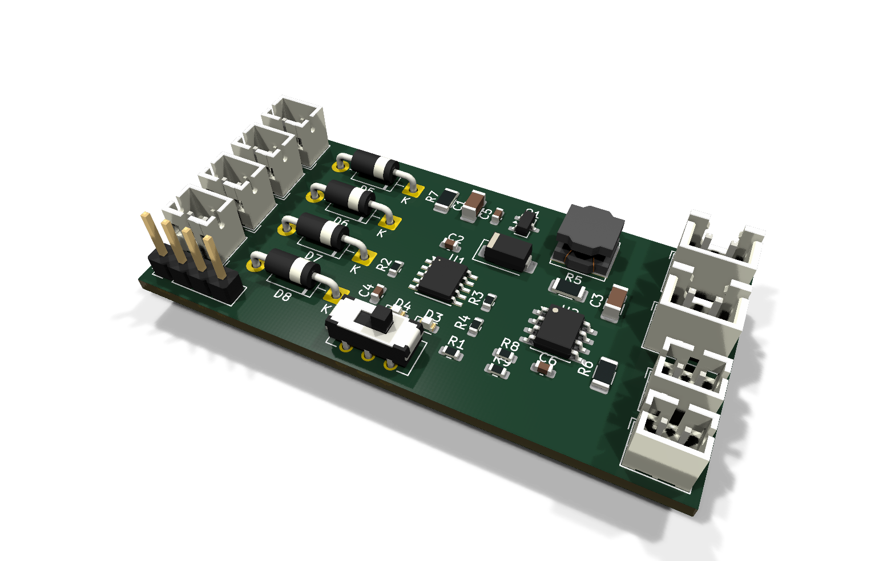
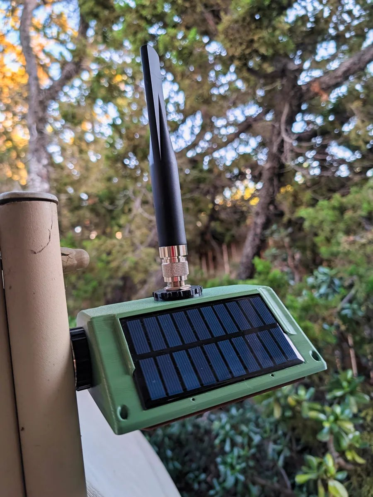
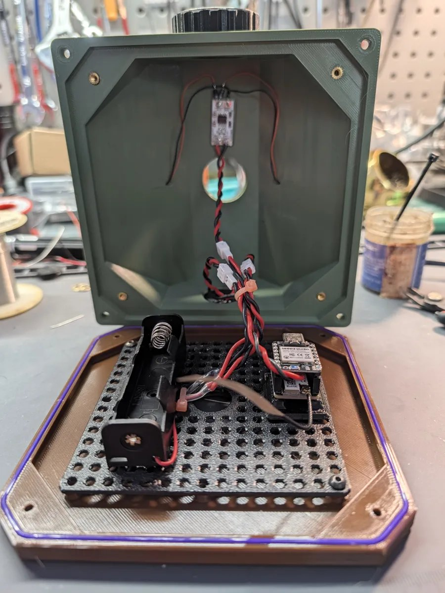
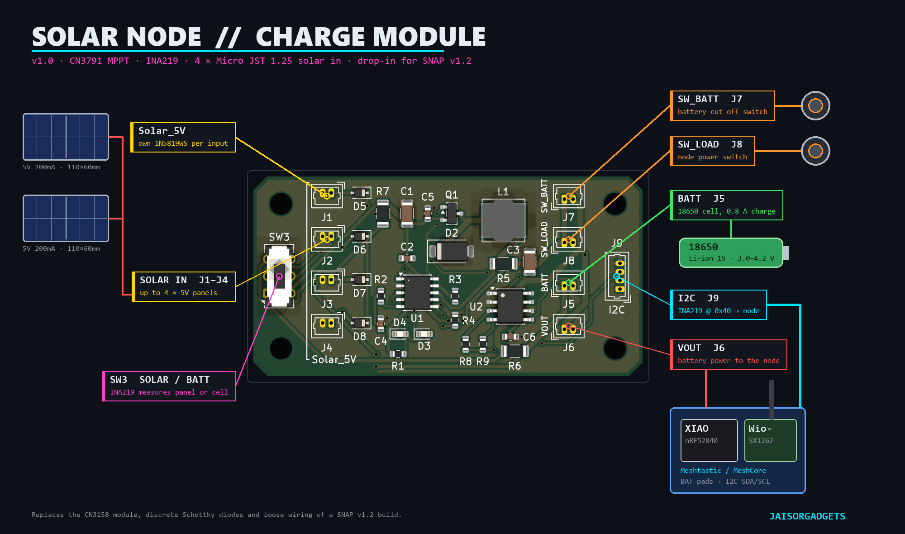
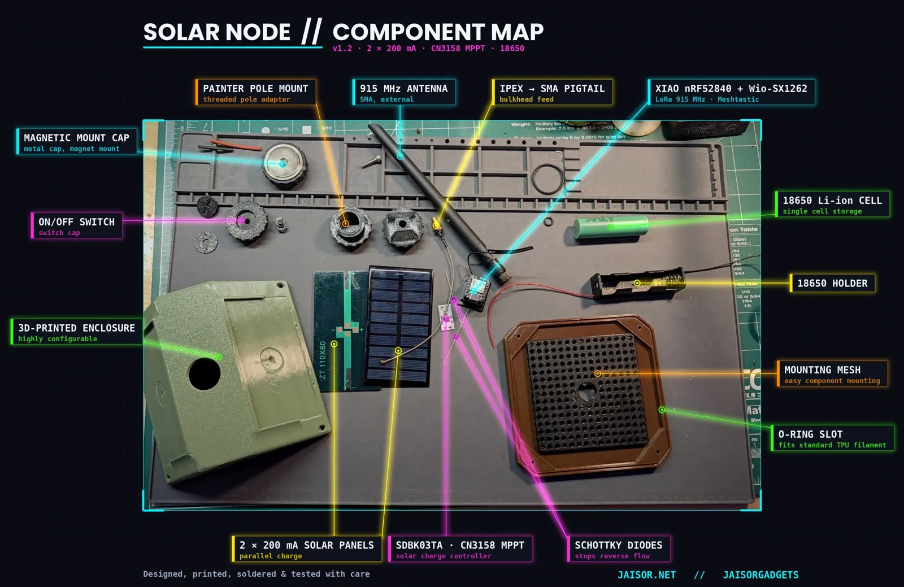
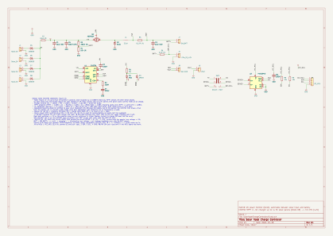
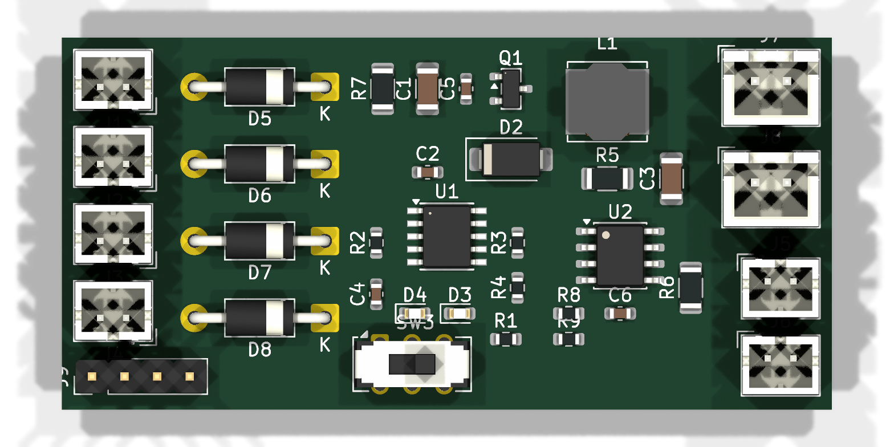
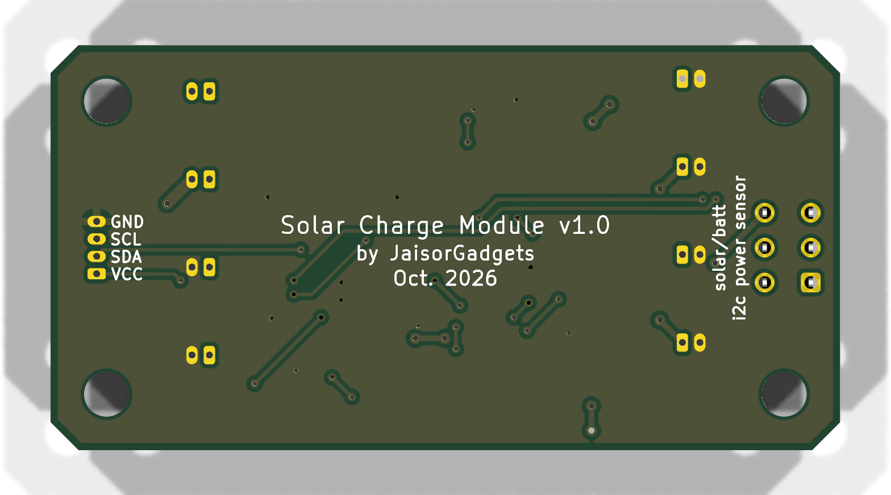

# Solar Node Charge Controller

A small solar charger board for a single-cell (1S) Li-ion/LiPo battery, built for solar-powered LoRa mesh nodes such as [SNAP v1.2](https://makerworld.com/en/models/3360988-snap-v1-2-solar-node-adaptable-platform-2x200ma). Up to four 5V panels feed a CN3791 MPPT buck charger. A switched output powers the node, and an INA219 reports voltage and current over I2C.

Designed in KiCad 10.

> **Status:** the schematic is complete and passes ERC. The PCB (56.5 × 29 mm, 2mm corner chamfers, four M3 mounting holes, two layers) is **placed and auto-routed** with a clean DRC, but hasn't had a manual layout review. Nothing has been built or tested yet.

<p align="center">
  
</p>

## Built for solar mesh nodes

This controller is meant for solar mesh nodes like the [SNAP v1.2: Solar Node Adaptable Platform](https://makerworld.com/en/models/3360988-snap-v1-2-solar-node-adaptable-platform-2x200ma). It simplifies their build in three ways:

- **Easy, clean connections:** the panels, battery, node and switches each plug into their own connector.
- **Improved solar charging:** an MPPT charger tuned for 5V panels, with a diode for every panel built into the board.
- **I2C power sensing:** configurable for either the battery or the solar circuit.

I2C power sensors are supported natively by both [Meshtastic](https://meshtastic.org) and [MeshCore](https://github.com/meshcore-dev/MeshCore). In most cases the node recognizes the INA219 automatically once it's connected.

<p align="center">
  
  
</p>

<p align="center">
  
</p>

In the SNAP v1.2 example build, shown below, the board replaces several separately wired parts:

<p align="center">
  
</p>

| Example build part | With this board |
|---|---|
| CN3158 MPPT module (SDBK03TA) | CN3791 MPPT buck charger, tuned for 5V panels (VIN held at 4.58V) and charging at 0.8A |
| One 1N5819 per panel, soldered inline | A 1N5819WS per input on the board, for up to four panels |
| Hand-soldered panel, battery and node wiring | Plug-in Micro JST 1.25 connectors for every connection |
| Latching on/off switch wired into the battery lead | Two switch connectors: SW_BATT cuts the battery, SW_LOAD cuts only the node |
| (none) | INA219 power monitor on I2C, switchable between the panels and the battery |

### Example wiring

| Board connector | Connects to |
|---|---|
| J1, J2 (Solar_5V) | Two [FellDen 5V 200mA 110×60mm panels](https://www.amazon.com/dp/B0BND5NYGK), the ones SNAP v1.2 uses. J3 and J4 take up to two more |
| J5 (BATT) | An 18650 Li-ion cell (1S, 3.0–4.2V) in its holder |
| J8 (SW_LOAD) | The SNAP on/off switch cap's latching button. To cut the battery entirely, use J7 (SW_BATT) as well, or instead |
| J7 / J8 left unswitched | Both switch connectors are in series with the power path, so an unused one needs a jumper (a plug with its two wires shorted). Otherwise the battery or the node stays disconnected |
| J6 (VOUT) | The XIAO nRF52840's BAT+ / BAT− pads, which is where SNAP powers it from the 18650 today |
| J9 (I2C) | XIAO 3V3 → VCC, D4 → SDA, D5 → SCL, GND → GND |

Set SW3 to BATT to see the battery's charge and discharge current, or to SOLAR to see what the panels deliver.

The INA219 uses address 0x40, which some other I2C sensors also use (for example the SHT21/HTU21D and HDC1080). If your node already has one of those, the two will clash.

In Meshtastic, enable power metrics in the telemetry settings so the readings are sent to the mesh.

## Features

- **Solar input:** up to four 5V panels in parallel (Micro JST 1.25), each isolated by its own 1N5819WS Schottky (SOD-323) so a shaded or unplugged panel doesn't drag the others down.
- **MPPT charging:** [CN3791](https://naylampmechatronics.com/img/cms/001216/CN3791.PDF) PWM buck charger with constant-voltage MPPT set to 4.58V input. Charges at 0.8A to 4.2V (CC/CV, trickle charge for deeply discharged cells, automatic recharge).
- **Battery and load switching:** connectors for two panel-mount switches. **SW_BATT** disconnects the battery from everything. **SW_LOAD** cuts only the output, so the battery keeps charging.
- **Output:** VOUT connector (Micro JST 1.25) that powers the module from the battery.
- **Power monitoring:** [INA219](https://www.ti.com/lit/ds/symlink/ina219.pdf) at I2C address 0x40. A slide switch selects whether it measures the solar input or the battery (bidirectional current plus voltage).
- **Status LEDs:** red while charging, green when charging is done.

## Schematic

[](docs/images/schematic.svg)

The schematic follows the CN3791 datasheet's typical application circuit (Figure 1), with these changes:

| Item | Value | Why |
|---|---|---|
| Charge current | 0.8A (R5 = 0.15Ω) | I<sub>CH</sub> = 120mV / R5. Leaves margin on the 1.0A-rated connectors; use 0.24Ω for 0.5A with small cells. |
| MPPT setpoint | 4.58V at VIN (R3/R4 = 28.0k/10k) | V<sub>MPPT</sub> = 1.205V × (1 + R3/R4). The panels sit one diode drop higher (~4.9–5.0V), about the max-power voltage of a typical 5V panel. |
| Blocking diode D1 | omitted | The input diodes already stop the battery feeding back into the panels. Leaving D1 out saves ~0.4V of headroom; the trade-off is ~21µA of battery drain in the dark. |
| Inductor | 22µH, Bourns SRN6045TA | Meets the datasheet's L > 5 × (VCC − VBAT) µH, with ~0.2A ripple. |
| Input diodes | 1N5819WS, SOD-323 (40V/1A) | The panels peak at ~200–300mA each, so the SMD part has plenty of margin and saves ~12mm of board width over DO-41. |

## PCB

<p align="center">
  
  
</p>

| Area | Parts |
|---|---|
| Left end | M3 mounting holes H1/H3 in the corners, with the SOLAR/BATT selector SW3 between them |
| Left column | Solar inputs J1–J4, each with its 1N5819WS (D5–D8) |
| Top middle | Buck power stage in current-flow order: R7, C1/C5, Q1, D2, L1, R5, C3 |
| Middle | CN3791 (U1) with its support parts and status LEDs |
| Right middle | INA219 (U2), I2C pull-ups, battery shunt R6 |
| Right column | SW_BATT/SW_LOAD switch leads (J7/J8), battery J5, VOUT J6 |
| Right end | M3 mounting holes H2/H4 in the corners, with the 4-pin I2C connector J9 between them |

Every reference label sits next to its own part, clear of pads, other parts and the edge (DRC reports no silkscreen issues). The holes are plain non-plated 3.2mm M3 holes, 4mm in from each edge.

**Silkscreen labels:**

- **Connector functions:** vertical labels beside the right-hand connectors read `SW_BATT` (J7), `SW_LOAD` (J8), `BATT` (J5) and `VOUT` (J6).
- **Solar inputs:** one `Solar_5V` label, with a bracket along the four solar inputs (J1–J4).
- **I2C connector:** `I2C` under J9 on the front. The pin names (`VCC`, `SDA`, `SCL`, `GND`) are printed beside its pads on the back, since there's no room between the pads and the connectors on the front.
- **SOLAR/BATT selector:** `solar/batt` / `i2c power sensor` beside SW3 on the back, with "solar" at the end of the switch that has the PV pins and "batt" at the end with the battery pins.
- **Back:** the module ID, "Solar Charge Module v1.0 / by JaisorGadgets / Oct. 2026".

**Routing** (by `tools/route-pcb.py`):

- **Ground:** the bottom layer is a solid GND plane. The top layer has a GND fill, and every surface-mount GND pad gets its own via down to the plane.
- **Track widths:** power paths are 0.8mm, necked to 0.4mm at small pads. Signals are 0.25mm.
- **Kelvin sensing:** the CN3791's current-sense pins and the INA219 selector's throws connect straight to the pads of their shunt resistors (R5, R6, R7).
- **Layer use:** about 80% of the copper length is on the top layer. The bottom-side tracks are short jumps, which keeps the ground plane mostly intact.
- **Size:** 206 track segments and 45 vias, 11 of which are GND stitching vias.
- **Checks:** DRC reports 0 violations and 0 unconnected items, and schematic parity is clean.

This is auto-routing, so review it before ordering, especially the buck converter's switching loop (C1 → Q1 → D2, which currently returns through the ground plane) and the few bottom-layer tracks that cut the plane.

Still to do: a manual layout review before ordering (see Fabrication).

## Connectors

| Ref | Connector | Pin 1 | Pin 2 | Notes |
|---|---|---|---|---|
| J1–J4 | Micro JST 1.25, 2-pin | Panel + | GND | 5V solar panels, any combination of 1–4 |
| J5 | Micro JST 1.25, 2-pin | Battery + | GND | 1S Li-ion/LiPo, 4.2V |
| J6 | Micro JST 1.25, 2-pin | VOUT | GND | Battery voltage out to the powered module, through SW_LOAD |
| J7 | Micro JST 1.25, 2-pin | VBAT (charger) | BATT+ (battery) | SW_BATT: panel-mount SPST switch, rated ≥1A or the module's peak current |
| J8 | Micro JST 1.25, 2-pin | VBAT | VOUT | SW_LOAD: panel-mount SPST switch, same rating |
| J9 | Micro JST 1.25, 4-pin | VCC (3.3–5V) | SDA | Pin 3 = SCL, pin 4 = GND. VCC comes from the MCU and powers the INA219. |

All connectors are Micro JST 1.25 (Molex PicoBlade-compatible) vertical headers, Molex 53047-0210 (2-pin) and 53047-0410 (4-pin). They mate with standard female cable housings (Molex 51021). Notes:

- **Current:** PicoBlade contacts are rated 1.0A. The charge current is set to 0.8A to stay under that on the battery (J5) and SW_BATT (J7) connectors. Keep the module's load current under 1A too, since it flows through J5 and J7 when the panels are dark.
- **No keying between functions:** every power connector is the same 2-pin type, so a switch lead fits a solar or battery socket. Check the silkscreen before plugging in.
- **Battery polarity:** "JST 1.25" LiPo pigtails have no standard polarity. Check that red goes to pin 1 (Battery +) before connecting.

**Operating note:** if SW_BATT is off while the panels are in sun, the charger sees no battery and VBAT pulses around 4.2V. Keep SW_LOAD off in that state.

## Power monitor (INA219)

- **Address:** 0x40 (A0 = A1 = GND).
- **Shunts:** both are 0.1Ω, the same as common INA219 breakout boards, so the default 32V/2A calibration in the usual libraries (e.g. Adafruit_INA219) works unchanged: about ±3.2A full scale, 0.8mA resolution.
- **Pull-ups:** R8/R9 are 10k I2C pull-ups to the MCU's VCC. Leave them off if the MCU board already has pull-ups.

| SW3 position | Shunt | Current | Bus voltage |
|---|---|---|---|
| SOLAR | R7, between the PV bus and VIN | Panel current, always ≥ 0 | VIN (panel voltage minus the diode drop) |
| BATT | R6, between BATT+ and the cell | Positive while charging, negative while discharging | Cell voltage, readable even with SW_BATT off |

The MCU can't sense SW3's position. Firmware has to know which position is set, or infer it from the readings.

## Fabrication

The fabrication package is generated into `SolarNodeChargeController/output/fab/`. It isn't tracked in git, so attach it to a release instead:

| File | Contents |
|---|---|
| `SolarChargeModule_v1.0_gerbers.zip` | Upload this to the board house. 9 Gerber X2 layers (copper, mask, paste and silkscreen on both sides, plus the outline), a Gerber job file, plated and non-plated Excellon drill files, and drill maps |
| `FAB_NOTES.txt` | Order settings: 2 layers, FR-4 1.6mm, 1oz copper, 56.5 × 29mm, 0.25mm/0.2mm minimum track/space, 0.3mm minimum drill, tented vias, four 3.2mm non-plated holes. Also assembly cautions |
| `SolarChargeModule_v1.0_BOM.csv` | BOM in JLCPCB format (Comment, Designator, Footprint, LCSC Part #), plus a Manufacturer Part column for the specific parts |
| `SolarChargeModule_v1.0_CPL.csv` | Pick-and-place file for top-side assembly, in the same coordinates as the Gerbers |

LCSC part numbers are only filled in where verified (D5–D8). Pick the rest in the assembler's part search, and check rotation and polarity in their preview. The PicoBlade headers and SW3 are through-hole parts.

Regenerating the package (after the board is final and DRC is clean):

```bash
OUT=SolarNodeChargeController/output/fab
P=SolarNodeChargeController/SolarNodeChargeController
kicad-cli pcb export gerbers --layers F.Cu,B.Cu,F.Paste,B.Paste,F.Silkscreen,B.Silkscreen,F.Mask,B.Mask,Edge.Cuts --subtract-soldermask --check-zones -o $OUT/gerbers $P.kicad_pcb
kicad-cli pcb export drill --format excellon --excellon-units mm --excellon-zeros-format decimal --drill-origin absolute --excellon-separate-th --generate-map --map-format gerberx2 -o $OUT/gerbers/ $P.kicad_pcb
kicad-cli pcb export pos --format csv --units mm --side both -o $OUT/pos-kicad.csv $P.kicad_pcb
kicad-cli sch export bom --fields 'Value,Reference,Footprint,${QUANTITY}' --labels 'Comment,Designator,Footprint,Qty' --group-by 'Value,Footprint' --ref-range-delimiter '' --exclude-dnp -o $OUT/bom-kicad.csv $P.kicad_sch
node tools/fab-package.js $OUT
```

## Repository layout

```
SolarNodeChargeController/      KiCad project: .kicad_pro, .kicad_sch, .kicad_pcb
  SolarNode.kicad_sym           project symbol library (CN3791)
  sym-lib-table
tools/
  gen-schematic.js              generates the schematic (Node)
  place-pcb.py                  places footprints, labels, holes, outline (KiCad Python / pcbnew)
  route-pcb.py                  routes tracks, GND stitching vias and pours (run after place-pcb.py)
  make-diagram.py               draws docs/images/wiring-diagram.png from the board render
  fab-package.js                JLCPCB-style BOM/CPL, fab notes and Gerber zip from the kicad-cli exports
docs/images/                    images used in this README (snap/: photos from the SNAP v1.2 MakerWorld post)
CLAUDE.md                       design decisions and working notes
```

The schematic and the board layout are generated by scripts in `tools/`, and checked with `kicad-cli` ERC/DRC (including schematic parity). See [CLAUDE.md](CLAUDE.md) for the full design rationale and workflow. Generated outputs (`output/`: BOM, reports, fab files) are not tracked.

## Regenerating the design

The whole design can be rebuilt from the scripts. Run these from the repo root, with `kicad-cli` from KiCad 10:

```bash
# 1. Schematic (Node): rewrites the .kicad_sch, SolarNode.kicad_sym and sym-lib-table
node tools/gen-schematic.js SolarNodeChargeController
kicad-cli sch erc --format json --severity-all -o erc.json SolarNodeChargeController/SolarNodeChargeController.kicad_sch
# 2. Netlist for the board scripts
kicad-cli sch export netlist --format kicadxml -o net.xml SolarNodeChargeController/SolarNodeChargeController.kicad_sch
# 3. Board (KiCad's Python): placement + labels + holes + outline, then routing + GND pours (~5 min)
"C:/Program Files/KiCad/10.0/bin/python.exe" tools/place-pcb.py SolarNodeChargeController net.xml
"C:/Program Files/KiCad/10.0/bin/python.exe" tools/route-pcb.py SolarNodeChargeController
# 4. Check: expect 0 violations, 0 unconnected, 0 parity issues
kicad-cli pcb drc --schematic-parity --severity-all --format json -o drc.json SolarNodeChargeController/SolarNodeChargeController.kicad_pcb
```

The scripts overwrite their output files. Once you edit the schematic or board in KiCad, stop regenerating that file (or port your edits into the scripts first).

Refreshing the images in `docs/images/`:

```bash
kicad-cli sch export svg -o docs/images SolarNodeChargeController/SolarNodeChargeController.kicad_sch
kicad-cli pcb render --side top --width 1600 --height 900 --quality high --zoom 1.6 -o docs/images/pcb-top.png SolarNodeChargeController/SolarNodeChargeController.kicad_pcb
kicad-cli pcb render --side bottom --width 1600 --height 900 --quality high --zoom 1.6 -o docs/images/pcb-bottom.png SolarNodeChargeController/SolarNodeChargeController.kicad_pcb
kicad-cli pcb render --width 1600 --height 1000 --quality high --perspective --rotate "-40,0,-25" -o docs/images/pcb-iso.png SolarNodeChargeController/SolarNodeChargeController.kicad_pcb
```

(The schematic export is named `SolarNodeChargeController.svg`; rename it to `schematic.svg`.)

After refreshing `pcb-top.png`, redraw the wiring diagram with KiCad's Python, which includes Pillow and NumPy:

```bash
"C:/Program Files/KiCad/10.0/bin/python.exe" tools/make-diagram.py
```
